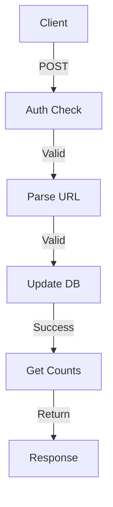

[`#Docs/2-Communication/data-flow.md`](#Docs/2-Communication/data-flow.md ):
```markdown
# Data Flow Architecture

## JSON Communication

sequenceDiagram
    Frontend->>Backend: 1. JSON.stringify(data)
    Backend->>Database: 2. Process & Store
    Database-->>Backend: 3. Fetch Data
    Backend->>Frontend: 4. JSON Response  
```

### Data Transformation
1. Frontend → Backend
- JavaScript object → JSON string
- WebSocket/HTTP send
- Go JSON unmarshal

2. Backend → Frontend
- Go struct → JSON marshal
- Send response
- JavaScript parse

```markdown
# Like System Data Flow

## Like/Dislike Flow


GitHub Copilot
Let me organize the documentation across the existing folder structure with clear separation of concerns.

Plan:

API documentation in Features
Implementation details in Database
Testing guide in Changelog
Flow diagrams in Communication
#Docs/3-Features/likes-system.md:

Response Formats
Success (200 OK)
Error (4xx/5xx)

### Error Handling Flow
```
graph TD
    A[Request] -->|Invalid| B[Error Check]
    B -->|401| C[Unauthorized]
    B -->|404| D[Not Found]
    B -->|400| E[Bad Request]
    B -->|500| F[Server Error]
    ```
    