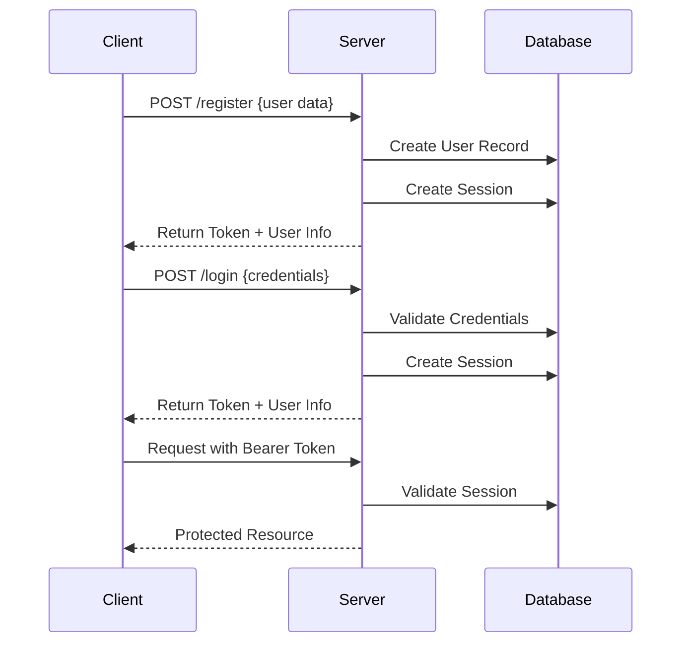

# Authentication Flow Documentation

## Overview
Authentication system handling login, registration, and session management.

## Flow Diagram

## Components
1. Frontend (JavaScript)

Login/Register Forms
Token Storage (localStorage)
Request Authentication
```
headers: {
    'Authorization': `Bearer ${token}`
}
```
2. Backend (Go)
User Authentication
Session Management
Token Generation/Validation

3. Database (SQLite)
User Records
Session Storage
Token Management

### Security Features
Password Hashing (bcrypt)
Session Expiration
Token Validation
CORS Protection
SQL Injection Prevention
### API Endpoints
POST /api/register
POST /api/login
GET /api/auth/status
POST /api/logout
### Error Handling
Invalid Credentials
Session Expiration
Token Validation Failures
Network Errors
