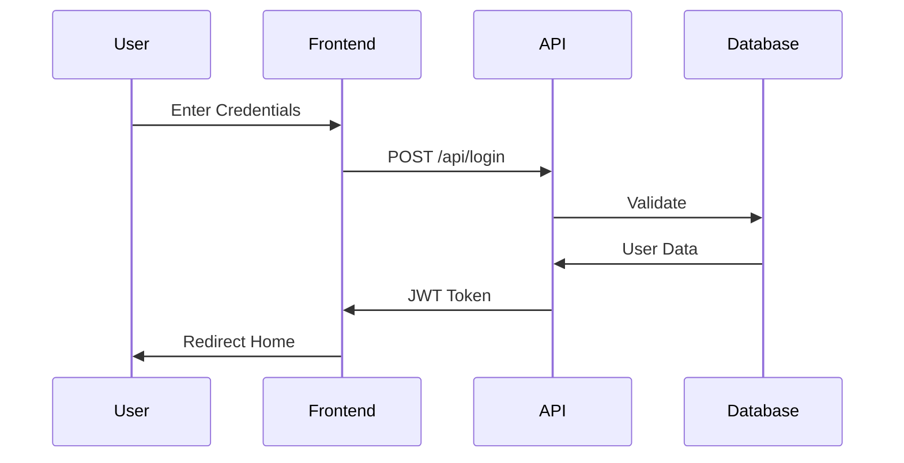

# Authentication Flow

## Login Process


## Registration Process
```
sequenceDiagram
    User->>Frontend: Fill Registration Form
    Frontend->>API: POST /api/register
    API->>Database: Create User
    Database->>API: Success/Error
    API->>Frontend: Response
    Frontend->>User: Show Result

```

```
sequenceDiagram
    participant U as User
    participant AC as Auth Component
    participant S as Server
    
    U->>AC: Enter Credentials
    AC->>S: POST /api/login
    S->>AC: Return Token
    AC->>U: Show Success
    Note over AC: Store Token
    AC->>U: Redirect Home
    ```