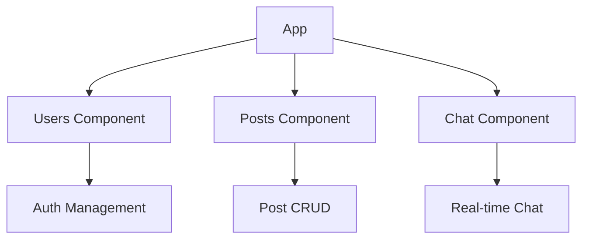

2. Create JavaScript documentation in `#Docs/3-Features/frontend-components.md`:

```markdown
# Frontend Components Documentation

## 1. Component Structure


2. Authentication Flow   
```
sequenceDiagram
    participant U as User
    participant AC as Auth Component
    participant S as Server
    
    U->>AC: Enter Credentials
    AC->>S: POST /api/login
    S->>AC: Return Token
    AC->>U: Show Success
    Note over AC: Store Token
    AC->>U: Redirect Home
```

3. Component Implementation

UsersComponent
{
    "responsibilities": [
        "Authentication",
        "Registration",
        "Session Management"
    ],
    "methods": {
        "login": "Handle user login",
        "register": "Create new account",
        "logout": "Clear session"
    }
}

PostsComponent
{
    "responsibilities": [
        "Display posts",
        "Handle interactions",
        "Manage comments"
    ],
    "methods": {
        "renderPosts": "Display post list",
        "handleLike": "Process likes",
        "showComments": "Toggle comments"
    }
}

ChatComponent
{
    "responsibilities": [
        "Real-time messaging",
        "User status",
        "Message history"
    ],
    "methods": {
        "sendMessage": "Send private message",
        "updateStatus": "Track user status",
        "loadHistory": "Show chat history"
    }
}

## 4. State Management
stateDiagram-v2
    [*] --> Login
    Login --> Authenticated: Success
    Authenticated --> Posts: View Posts
    Authenticated --> Chat: Open Chat
    Chat --> MessageFlow: Send/Receive
    Posts --> Interaction: Like/Comment


Progress Tracking:
Authentication Component ✅
Posts Management ✅
Real-time Chat ✅