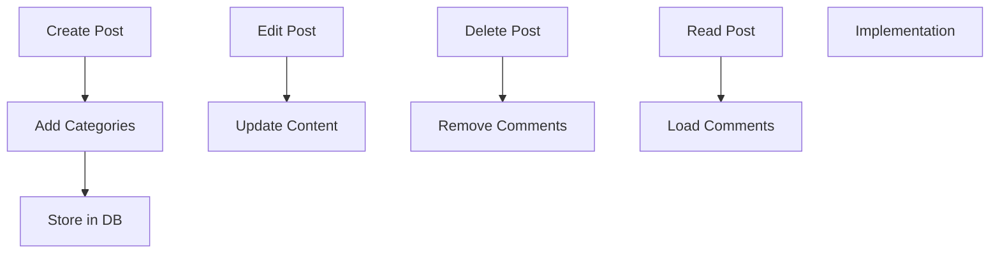

`3-Features/frontend/posts/crud.md`:
```markdown
# Post Management

## Operations

{
    "PostsComponent": {
        "create": "Create new post",
        "update": "Edit existing post",
        "delete": "Remove post",
        "list": "Show all posts"
    }
}
```
