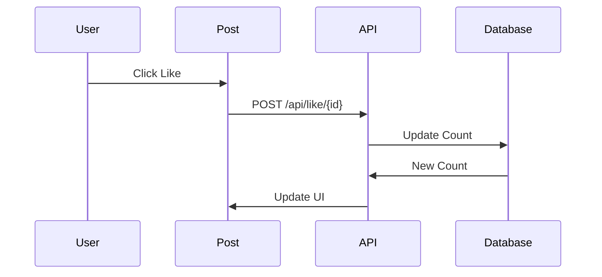

# Post Interactions

## Like System

## Comment System
```
graph TD
    A[Add Comment] --> B[Store in DB]
    B --> C[Update UI]
    D[Load Comments] --> E[Display Thread]
```

## Implementation
```
{
    "interactions": {
        "like": "Handle post likes",
        "comment": "Manage comments",
        "share": "Share functionality"
    }
}
```