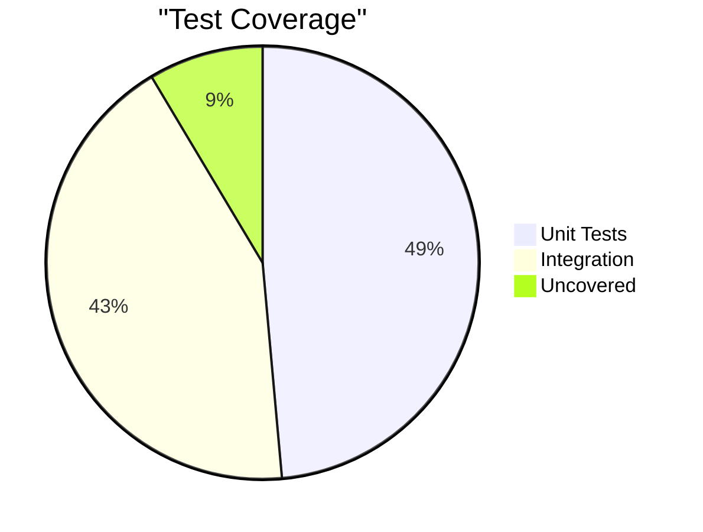

`4-Database/testing/coverage.md`:
```markdown
# Test Coverage

## Goals
- Unit Tests: 80%
- Integration Tests: 70%
- Critical Paths: 100%

## Current Coverage


## Critical Paths
Authentication
Data Persistence
WebSocket Communication
Concurrent Operations
