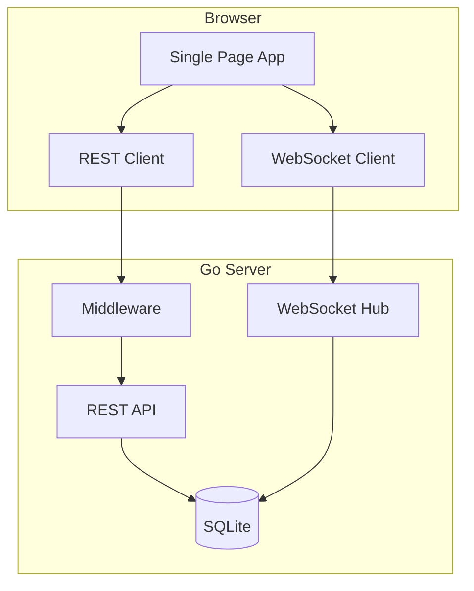

# Real-Time Forum Overview

## Architecture Overview


### Core Components
1. Frontend (SPA)

- Dynamic content loading
- Real-time communication
- State management

2. Backend (Go)

- REST API handlers
- WebSocket management
- Database operations

3. Features

- Authentication
- Posts & Comments
- Real-time messaging
- Categories & Likes

```
#Docs/
├── 1-Setup/         # Setup and configuration
├── 2-Communication/ # API and protocols
├── 3-Features/      # Feature documentation
└── 4-Database/      # Database design
```