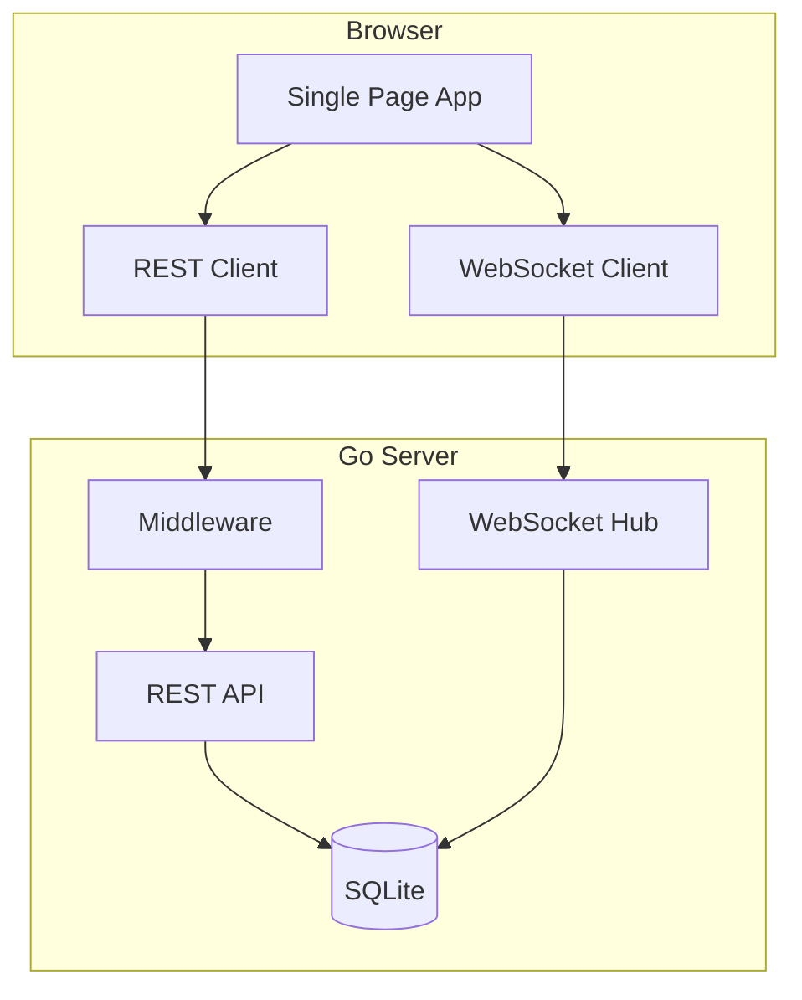

# Real-Time Forum Overview

## Architecture Overview

### Core Components
1. Frontend (SPA)

- Dynamic content loading
- Real-time communication
- State management

2. Backend (Go)

- REST API handlers
- WebSocket management
- Database operations

3. Features

- Authentication
- Posts & Comments
- Real-time messaging
- Categories & Likes

# Documentation Overview

## 1. Setup & Architecture
- [`1-Setup/architecture.md`](1-Setup/architecture.md)
  - System components diagram
  - Infrastructure setup
  - Dependencies and requirements

## 2. Communication
- [`2-Communication/data-flow.md`](2-Communication/data-flow.md)
  - Data transformation flows
  - Request/response cycles
- [`2-Communication/rest-api.md`](2-Communication/rest-api.md)
  - API endpoints
  - Request/response formats
- [`2-Communication/websocket.md`](2-Communication/websocket.md)
  - WebSocket implementation
  - Real-time communication
  - Connection management

## 3. Features
### Backend
- [`3-Features/backend/api-documentation.md`](3-Features/backend/api-documentation.md)
  - API specifications
  - Error handling
- [`3-Features/backend/auth-flow.md`](3-Features/backend/auth-flow.md)
  - Authentication process
  - Session management
- [`3-Features/backend/likes-system.md`](3-Features/backend/likes-system.md)
  - Like/dislike functionality
  - Vote tracking
- [`3-Features/backend/posts-comments.md`](3-Features/backend/posts-comments.md)
  - Post management
  - Comment system

### Frontend
- [`3-Features/frontend/auth/`](3-Features/frontend/auth/)
  - [`flow.md`](3-Features/frontend/auth/flow.md): Authentication flow
  - [`implementation.md`](3-Features/frontend/auth/implementation.md): Component details
- [`3-Features/frontend/chat/`](3-Features/frontend/chat/)
  - [`real-time.md`](3-Features/frontend/chat/real-time.md): Chat features
  - [`websocket.md`](3-Features/frontend/chat/websocket.md): WebSocket client
- [`3-Features/frontend/posts/`](3-Features/frontend/posts/)
  - [`crud.md`](3-Features/frontend/posts/crud.md): Post operations
  - [`interactions.md`](3-Features/frontend/posts/interactions.md): User interactions

## 4. Database
- [`4-Database/queries.md`](4-Database/queries.md)
  - Common queries
  - Performance optimization
- [`4-Database/schema.md`](4-Database/schema.md)
  - Database structure
  - Table relationships
- [`4-Database/testing/`](4-Database/testing/)
  - [`concurrent.md`](4-Database/testing/concurrent.md): Concurrency tests
  - [`coverage.md`](4-Database/testing/coverage.md): Test coverage
  - [`integration.md`](4-Database/testing/integration.md): Integration tests
  - [`unit.md`](4-Database/testing/unit.md): Unit tests

## 5. Changelog
- [`5-Changelog/database.md`](5-Changelog/database.md)
- [`5-Changelog/handlers.md`](5-Changelog/handlers.md)
- [`5-Changelog/models.md`](5-Changelog/models.md)
- [`5-Changelog/structure.md`](5-Changelog/structure.md)

## Progress Tracking
✅ Setup & Architecture
✅ Communication Protocols
✅ Database Schema
✅ Authentication System
✅ Post Management
✅ Real-time Chat
⏳ Testing Documentation